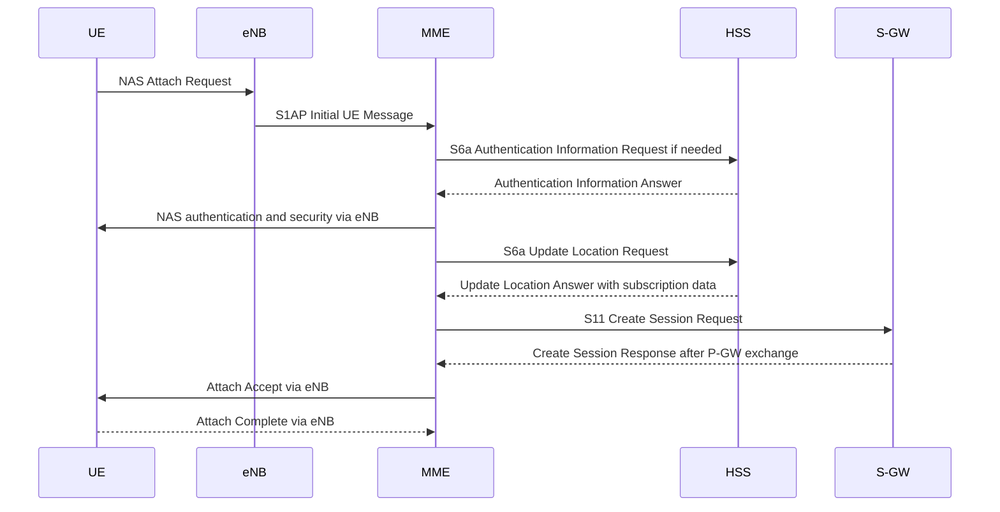

# LTE core operations lab
     
This self-contained lab models LTE attach outcomes with synthetic event records. It demonstrates first-pass fault isolation across access, transport and the Evolved Packet Core (EPC). The CSV is a teaching fixture with deliberately frequent failures.

## Quick start

From the profile repository root, run this with Python 3. No external packages are required.

```sh
python3 telecom/triage.py telecom/attempts.csv
```

| KPI | Calculation | Fixture result |
| --- | --- | --- |
| Attach success | Completed attaches / unique attempts | 5 / 10 (50%) |
| Median attach latency | Median on completed attempts | 220 ms |
| Leading failure category | Highest count among failed attempts | S6a authentication timeout (2 of 5 failures) |

## Trace the attach

This simplified control-plane view covers initial EPS attach. It omits optional steps and detailed bearer signalling.



## Incident walkthrough

Attempts a06 and a07 reached the modeled S6a authentication stage and timed out. Start by comparing MME and HSS transaction IDs and timestamps. Check Diameter peer status, routing and upstream response times before attributing the incident to the HSS. For a08, an explicit missing-profile result warrants checking the test subscriber's service and APN entitlements. For a09, confirm whether the eNodeB sent the Initial UE Message and whether the MME saw it. For a10, look for the S11 response, then check the S-GW to P-GW path.

After an approved change, repeat a known-good and known-failing test attach, verify the expected stage and KPI trend against a comparable baseline, and record the change, owner, timestamps, evidence and rollback trigger.

## Validation checklist

| Area | Expected evidence |
| --- | --- |
| Provisioning | Allowed test profile attaches to the authorized APN. Missing or mismatched profile follows the expected reject path. |
| Authentication | Valid test credentials complete NAS authentication. Invalid credentials and peer timeouts produce distinct outcomes. |
| Charging | In a separate controlled test, correlate successful bearer use with expected charging records or quota behavior. Verify retries against charging and session identifiers. |
| Roaming and interconnect | In a partner test environment, verify the visited and home network paths, subscriber authorization, selected routing and expected service. Capture the failing interface and result code when a scenario fails. |
| Node rollout | Capture pre-change peer health and KPIs, validate a canary attach, document rollback criteria and compare post-change results. |

The runnable fixture covers attach outcomes. Charging, roaming and rollout entries are test design examples. For 3G UMTS and 2G GSM/GPRS, compare packet-domain SGSN/GGSN flows and use RAT-specific procedures and denominators when comparing KPIs.

Reference: [3GPP TS 23.401 via ETSI, clause 5.3.2.1](https://www.etsi.org/deliver/etsi_ts/123400_123499/123401/17.11.00_60/ts_123401v171100p.pdf).
